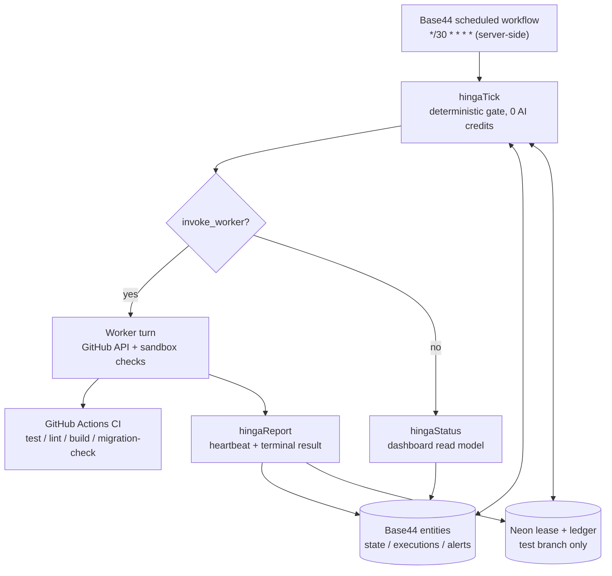

# Mission 003 - Autonomous Engineering Automation (Base44 + GitHub + Neon)

Status: implemented and armed. Mission completion has **not** been declared (see
`docs/mission_003_automation_report.md`).

## 1. Capability audit (done before writing any code)

| # | Required capability | Base44 verdict | Evidence / handling |
|---|---|---|---|
| 1 | Server-side recurring scheduler | **SUPPORTED** | Workflow `scheduled` trigger, cron `*/30 * * * *`. Runs without a browser, survives restarts, supports pause/activate/archive. |
| 2 | Background workers | **PARTIAL** | No long-running process. Workflow steps execute sequentially, each request-scoped. Long work is modelled as a *lease + heartbeat* so any runtime can own a step. |
| 3 | Persistent database jobs | **SUPPORTED** | Base44 entities (`HingaExecution`, `HingaAutomationState`, `HingaAlert`) are the durable ledger. Neon holds the same contract in SQL for cross-runtime sharing. |
| 4 | Secrets management | **SUPPORTED** | Platform secrets store; values never enter workflow JSON, entity records, logs or PR text. |
| 5 | GitHub API integration | **SUPPORTED** | Fine-grained PAT (repo write, verified `permissions.push=true`). Used from the worker turn only. |
| 6 | Invoking an external AI worker securely | **READY, NOT CONNECTED** | `hingaTick` accepts HMAC-SHA256 signed requests (`x-hinga-signature` + `x-hinga-timestamp`, 5-minute window) when `HINGA_WEBHOOK_SECRET` exists. Manus currently runs through its own internal `ScheduleTask`, so no HTTP endpoint exists to call. Nothing was invented for it. |
| 7 | Execution logs and health monitoring | **SUPPORTED** | `HingaExecution` rows, `HingaAlert` rows, workflow run history, and `hingaStatus` read model. |

### Blockers found (reported, not invented around)

1. **Base44 cannot run the repository's test suite.** Backend functions are single-file,
   request-scoped and have no repo checkout, so `npm test`, `npm run lint`,
   `npm run build` and `npm run db:migration-check` cannot execute inside them.
   *Resolution:* `.github/workflows/ci.yml` runs all four checks on every push to the
   mission branch and on PRs into `main`. CI check runs are the external test evidence
   the completion gate requires. The worker also verifies locally in its own sandbox
   before pushing.
2. **Manus has no callable endpoint.** `MANUS_WORKER_URL` / `MANUS_API_KEY` are not
   needed and were removed from the secret set. The signed-claim path stays available
   for the day Manus or any other runtime can accept a dispatch.
3. **Neon test branch credentials.** Resolved: `NEON_TEST_DATABASE_URL` points at
   `mission-003-test-20261030` (endpoint `ep-dawn-feather-b9v9sfi1`, distinct from the
   production endpoint `ep-spring-bird-b9487jij-pooler`). Production was never used.
4. **Session advisory locks are unusable over the pooled HTTP driver.** `pg_advisory_lock`
   needs a stable session; the serverless driver is stateless. The lease is therefore an
   atomic conditional upsert plus a partial unique index, which gives the same guarantee
   without holding a connection.

## 2. Architecture

Ordering inside `hingaTick` is deliberate:

1. authenticate (admin session **or** valid HMAC signature, nothing else)
2. load/create automation state, roll the daily budget window
3. short-circuit on `completed` / `paused` / `disabled`
4. recover stale executions (`heartbeat_at` older than `heartbeat_stale_minutes`)
5. refuse when an execution is live and the lease is valid -> `already_running`
6. cost controls (executions/day, AI USD/day)
7. retry policy (transient vs permanent, exponential backoff, max attempts)
8. atomic claim: create execution -> take lease -> re-read and verify ownership
9. return `invoke_worker` with execution id, branch, PR and budget snapshot

## 3. Components

| Component | Where | Responsibility |
|---|---|---|
| Scheduler | Base44 workflow | Fires every 30 minutes, server-side, pause/resume/disable supported |
| Gate | `hingaTick` | Single decision point; no AI cost; enforces budgets, lease, retry, recovery |
| Ledger | `HingaExecution` + `hinga_executions` | Durable execution record with idempotency key and heartbeat |
| Lease | `HingaAutomationState.current_*` + `hinga_worker_leases` | One worker per mission, expiry, takeover after death |
| Worker | Agent turn | Checks branch/PR, picks one small unfinished step, edits, verifies, commits to the mission branch only |
| Result recorder | `hingaReport` | Heartbeat, terminal result, evidence enforcement, alerts, lease release |
| Control plane | `hingaControl` | pause / resume / disable / enable / complete / reset_budget / set_config |
| Dashboard | `hingaStatus` | Read model for status, worker, budgets, alerts, completion readiness |
| CI | GitHub Actions | Independent test/lint/build/migration evidence |

## 4. Data model

`db/migrations/004_execution_ledger.sql` (applied to the test branch only):

- `hinga_executions` - the requested columns plus `worker_mode`, `max_attempts`,
  `estimated_cost_usd`, `actual_cost_usd`, `test_summary JSONB`.
- `idx_hinga_executions_single_active` - partial unique index on `(mission_id)` where
  status is `queued`/`running`. The database itself refuses a second concurrent execution.
- `hinga_worker_leases` - `lease_key`, `worker_id`, `execution_id`, `heartbeat_at`,
  `expires_at`, `released_at`.
- `hinga_automation_state` - scheduler status, run timestamps, budget counters.

Base44 entities mirror this so the loop works even when the Neon test branch is
unavailable, and Neon holds the cross-runtime contract for Base44 + Manus.

## 5. Security boundaries (enforced, not advisory)

| Rule | Enforcement point |
|---|---|
| Never write to `main` | Worker pushes only to `mission-003-independent-work`; `assertSafeTargets()` rejects `base: main` with a write operation |
| Never merge the PR | No merge call exists in the worker path; merge stays a human action |
| Never touch Neon production | Migrations refuse without `NEON_BRANCH != production` + unpooled URL; `set_config` rejects `neon_test_branch=production`; `assertSafeTargets()` blocks empty/production branch |
| No role/grant/RLS/fine-tuning actions | `assertSafeTargets()` rejects the operation allowlist violation with `POLICY_VIOLATION` |
| No secrets in logs, PRs or records | `hingaReport` redacts GitHub tokens, database URLs, bearer tokens, API keys and JWTs before storage; secrets live only in the platform secret store |
| No completion without evidence | `hingaReport` downgrades a `succeeded` claim to `failed` (`TEST_FAILED`) unless tests+lint+build all report `passed`; `hingaControl complete` returns 409 unless all eight evidence items are true |

## 6. Cost controls

- Per-execution timeout: `execution_timeout_minutes` (default 25) with heartbeat expiry.
- Daily execution budget: `daily_execution_budget` (default 8) enforced in `hingaTick`.
- Daily AI budget: `daily_ai_budget_usd` (default 1.50), incremented from reported
  `actual_cost_usd`; the gate stops the loop when exhausted.
- Never start a second execution while one is live (`already_running`).
- The gate itself costs no credits, so a 30-minute cadence does not burn AI credits
  while there is nothing to do or the budget is spent.
- Usage is stored per execution (`estimated_cost_usd`, `actual_cost_usd`) and surfaced
  by `hingaStatus`.

## 7. Alert catalogue

| Alert | Trigger |
|---|---|
| `WORKER_FAILURE` | Execution finished `failed` |
| `REPEATED_RETRIES` | Transient failure retried after backoff |
| `EXECUTION_TIMEOUT` | Execution finished `timed_out` |
| `EXECUTION_STALE_RECOVERED` | Running execution lost its heartbeat and was recovered |
| `GITHUB_AUTH_FAILURE` | `GITHUB_AUTH_FAILED` |
| `NEON_AUTH_FAILURE` | `NEON_AUTH_FAILED` |
| `DAILY_EXECUTION_BUDGET_REACHED` / `DAILY_AI_BUDGET_REACHED` | Budget exhausted |
| `PERMANENT_FAILURE_BLOCKED` | Permanent error, retry refused |
| `MAX_ATTEMPTS_EXHAUSTED` | Attempts used up |
| `PRODUCTION_ACTION_REQUESTED` | Production operation attempted and denied |
| `MISSION_BLOCKED` | Execution marked blocked |
| `MISSION_COMPLETED` | Evidence complete, scheduler stopped |

Alerts are deduplicated per type per 24 hours so a 30-minute loop cannot flood.
